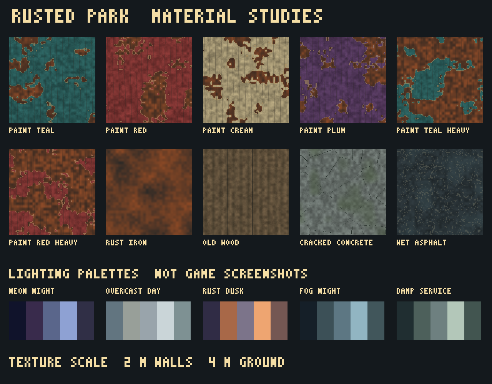

# Rusted Park — художественное направление

Версия от 13 ноября 2026, обновлена 17 ноября по пользовательскому фидбеку. Это стандарт для всех 27 игр. Два эталона оформления, Balloons и Mascots, проверены из игры; повторная проверка исправленного Mascots подтверждена пользователем 17 ноября. Применение профилей к остальным играм сопровождается отдельной проверкой их целей и камер.

## Образ парка

Парк закрыли, но электричество отключили не везде. Облупившиеся киоски и ржавые механизмы стоят рядом с работающими вывесками, тиром и автоматами. Вода, грязь и проросшая растительность показывают возраст места; смешные маскоты и крупные цирковые формы сохраняют характер Pummel Party. Атмосфера тревожная и абсурдная, без фотореализма и без потери видимости игроков.

Каждая сцена должна узнаваемо изображать конкретное место: тир, депо, театр, ярмарочную улицу, служебный двор. Цветной пол с экраном не считается законченным аттракционом. Текущие эталоны проверяют материалы и свет; переделка игровых помещений по фидбеку — следующий этап.

## Цвет и поверхности

Основа: угольный `#283135`, грязный бирюзовый `#275755`, старая красная краска `#77312F`, кремовый `#9D906E`, сливовый `#4F3558`, железо `#5D3422`. Это исходные цвета материалов до освещения.

Акценты: фиолетовая вывеска, зелёная аварийная лампа, красный сигнал, синий прожектор. На сцену выбирать два ведущих акцента; нейтральный свет отдельно освещает правила, лица маскотов и ответы. Цвет опасности сопровождать формой, движением или звуком. Декоративные лампы не должны выглядеть как доступный ответ или активная ловушка.

Материал показывает несколько масштабов износа: крупные островки оставшейся краски, ржавые края, мелкие потёки и грязь. Более сильный износ — на нижних панелях, стыках и внешних служебных стенах. Игровые отметки и текст сохранять чистыми. Не растягивать один рисунок на весь фасад.

В [библиотеке](assets/art-direction/materials.json) десять материалов: четыре цвета краски, два варианта сильного износа, ржавое железо, дерево, бетон и мокрый асфальт. PNG 512 × 512 RGB, отдельные параметры гладкости/металличности; повторение по UV — примерно 2 м на стенах и 4 м на земле. Противоположные края текстур совпадают. Это албедо, без карт нормалей и без обещания физической симуляции воды.

На кубических текстурированных поверхностях эталонов используется `assets/art-direction/surface_cube.obj` с явными UV всех шести граней и единичными габаритами. Встроенный `PROP_CUBE` в pmgen обозначает LowPolyCube; его развёртка не считается гарантированно подходящей для этих материалов. После первого игрового кадра Balloons эта зависимость устранена. Игровые кадры 15 ноября подтвердили фактуру обоих эталонов; доработанная читаемость карточек Mascots принята по повторной проверке пользователя 17 ноября.



## Пять профилей освещения

| Файл в assets/art-direction/lighting | Характер | Правило читаемости |
| --- | --- | --- |
| `neon-night.json` | Холодная синяя ночь, фиолетовые вывески, редкие зелёные лампы | Нейтральная подсветка карточек; туман начинается с 55 м |
| `overcast-day.json` | Холодное рассеянное небо, выцветшие поверхности | Детали пути читаются без декоративных источников; туман с 80 м |
| `rust-dusk.json` | Тёплый остаточный свет и включённые фонари | Тёплый фон не сливается с золотыми целями; туман с 70 м |
| `fog-night.json` | Холодные силуэты и локальный свет | Туман с 45 м, игровое решение должно оставаться ближе |
| `damp-service.json` | Сырой зелёно-серый двор и аварийные акценты | Вода отличается от безопасного мокрого пола; туман с 55 м |

Профили используют проверенную схему `ModLightingSettings`: градиентное окружение (`ambientMode=1`), глобальный свет, небо, линейный туман и движущиеся облачные тени. Начальная плотность и дистанции рассчитаны для локального места действия, а не для любого размера карты. Перед применением сравнить дистанцию до самой дальней обязательной цели с началом тумана. В длинных гонках увеличить дистанцию или отключить туман.

Локальные источники в эталонах — штатный `ModLight`, без теней; солнце остаётся единственным источником теней. В Mascots: 8 нейтральных подсветок карточек и 16 малых цветных источников на рамах. В Balloons: 4 тёплых фонаря. Производительность этих бюджетов на 4/8 локальных видах ещё требует измерения. Мерцание не добавлено: оно не должно имитировать таймер ответа.

Погодное настроение создаётся небом, облачными тенями, туманом и материалами. Дождь и пар частицами пока не добавлены. Постобработка остаётся исходной: усиленный bloom и цветокоррекция не должны ухудшить инструкции. Для собственного профиля использовать экспортированный игрой `PostProcessing.data`.

## Пространство и движение

Ближний план — само действие и ясная цель. Средний — корпуса аттракционов, створки, опоры и очереди. Дальний — силуэты колеса, горок, депо и шатров. Холмы и сухие деревья дополняют парк. Один крупный узнаваемый силуэт полезнее ряда случайных мелких объектов.

В эталонах добавлено медленно вращающееся дальнее колесо, в Balloons — фонари за ограждением, в Mascots — верхние панели и рамки экранов. Новые элементы не имеют коллизий. Исходные трансформы, спавны, триггеры, очки, таймеры и ИИ проверяются побайтово до/после оформления. План сверху и оба разреза лежат в `assets/art-direction/references/*/plan/`.

## Первое распределение профилей на 27 игр

20 ноября оформление установлено в первые десять проектов. Для остальных семнадцати таблица задаёт запланированные профили. Художественные эталоны Balloons и Mascots остаются отдельными проектами. [Статусы по играм и ссылки на кадры](WIKI.md).

| Профиль | Игры |
| --- | --- |
| Неоновая ночь | Ticket Rush, Mascot Throne, Rusty Teacups, Counterfeit Mascots, Midnight Parade, Closing Time, False Alarm |
| Пасмурный день | Coaster Run, Human Cannonball, Barrel Alley, Emergency Exit |
| Ржавые сумерки | Death Carousel, Mascot Range, Sugar Rush, Balloon Pop, Ferris Hold, Last Sale |
| Туманная ночь | Tilt House, Searchlights, Ghost Train, Shadow Theatre, Broken Clock |
| Сырой служебный сектор | Bumper Cars, Lost & Found, Crossed Wires, Boiler Jackpot, Trap Operators |

Особые условия: в Searchlights не осветлять безопасные укрытия до исчезновения контраста опасного луча; в Human Cannonball сохранить различимость колец и глубины; в Broken Clock не вводить ритмические световые/звуковые подсказки времени; в Bumper Cars влажность поверхности только визуальная.

### Исходная десятка, 20 ноября 2026

Библиотека эталонов применена к 330 объектам десяти сцен. В девяти играх добавлены 25 локальных источников света на существующих фонарях и колоннах. В Searchlights работают исходные девять источников. В Coaster Run начало тумана отодвинуто на 130 м, чтобы со старта был виден дальний участок трассы. В Tilt House сохранены сигнальные стены и осыпающиеся плиты, в Human Cannonball — исходные отметки прицеливания и колец.

Восемь исходных сборщиков применяют [оформление сцены](assets/art-direction/core_style.py) при сборке. Новая сборка получает световой профиль из таблицы, повторная сохраняет существующую настройку освещения. Для Searchlights и Bumper Cars исходным материалом служит сохранённый проект редактора. Пример создания оформленной копии из корня репозитория в PowerShell:

```powershell
$workshop = Join-Path $env:USERPROFILE 'AppData/LocalLow/Rebuilt Games/Pummel Party/WorkshopMods'
python packs/abandoned-park/assets/art-direction/core_style.py "$workshop/Searchlights" "local/styled/Searchlights"
```

На установке сверены SHA-256, исходная иерархия, трансформы и игровые компоненты. Повторное применение к каждой сцене дало одинаковые файлы. Видимость лучей, мишеней и предупреждений в новом освещении предстоит проверить с игровой камеры.

## Текст и проверка камерой

Общий `screen.obj` рассчитан на импорт Pummel Party с `ModCreatedVersion >= 1`: игра отражает X модели, но оставляет UV. В модели компенсирована координата U. PNG не отражаются. Для Shadow Theatre генератор отдельно компенсирует X и порядок вершин граней: геометрия после импорта совпадает с данными силуэта.

Обычный экран смотрит в -Z; зритель находится со стороны меньшего Z. Поворот `(90,0,0)` делает из него напольную табличку, смотрящую вверх. Отрицательный масштаб в сцене не нужен.

Предварительный ориентир в конечном игровом кадре: высота основной надписи от 24 пикселей, вторичной от 18, штрих от 2 пикселей. Это критерий проверки, а не уже измеренный результат. Если кадр делится между игроками, размер оценивается внутри каждого вида. Важные цифры должны читаться без движения камеры и приближения. При недостаточном размере укрупнять знак или сокращать текст; не повышать только разрешение PNG.

Не дублировать номер внутри одной таблички. Иллюстрации вариантов располагать по осям физических зон ответа; образец отделять от кандидатов. Центральное HUD-сообщение не должно закрывать отличия в момент, когда выбор уже открыт. Эти правила применены к Counterfeit Mascots после пользовательских кадров 15 ноября; нейтральная подсветка экрана усилена отдельно от цветного окружения.

Для проверки установлен **Rusted Park Text Check**: большой экран 16 × 8 м как в кабинке, напольная табличка, буквы F/R, цифры 2/5/7, стрелка вправо и образцы высотой 40/30/20 пикселей исходной текстуры. Красная полоса находится слева, зелёная справа. Размеры образцов — в PNG, а не обещание экранного размера.

Проверка: обычная игровая камера со старта, крайнее место, уменьшенный локальный вид, затем сетевой клиент. Стрелка направлена вправо, надписи читаются, номера физического ответа соответствуют изображению. В Shadow Theatre сравнить силуэт с фронтальной фазой правильной фигуры. Статический тест и план сверху не заменяют эти кадры.

## Сборка и сохранение настроек

```powershell
python packs/abandoned-park/assets/art-direction/generate.py
python packs/abandoned-park/assets/art-direction/build_references.py local/appearance-builds
python tools/test_appearance.py
```

Генератор материалов не требует внешних пакетов. `lighting_base.json` — снимок реального экспорта Minimal Third Person; остальные профили производятся из него. `checksums.json` фиксирует результаты генерации. Сборка эталонов создаёт **Rusted Park Art - Mascots**, **Rusted Park Art - Balloons**, **Rusted Park Text Check** отдельно от 27 основных игр.

API сборщика:

```python
mod.lighting_profile = str(assets / 'lighting/neon-night.json')
mod.post_processing_profile = str(exported_post_processing)  # необязательно; реальный экспорт игры
mod.write(workshop_dir)
```

Профиль заполняет отсутствующий файл. Если оформление уже существует, повторная сборка оставляет его и названия пресетов в Meta.json. Для сознательной замены выбранных профилей установить `mod.replace_appearance = True`; это отдельный режим, по умолчанию выключен. При замене одного профиля второй файл не затрагивается. Игра распознаёт пользовательский профиль как `Custom`; имя файла сохраняется в исходнике сборщика.

Источники формата: установленные `Assembly-CSharp.dll` (`PummelOBJImporter`, `ModLight`, `ModLightingSettings`) и шаблон Minimal Third Person; схема ModLight сверена с сохранённой сценой Searchlights. Справочник редактора: [импорт и оформление](../../.claude/skills/pummel-party-mod-editor/reference/editor-workflow.md); вики [Lighting Settings](https://workshop.pummelparty.com/wiki/Lighting_Settings), [Light Component](https://workshop.pummelparty.com/wiki/Light_Component).
